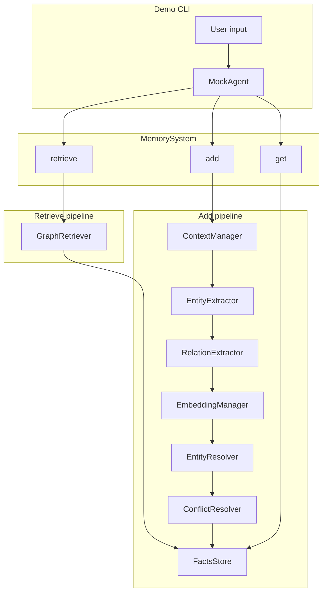

# Aion — Long-term memory for conversational agents
 
**Date:** October 2026

---

## Summary

Aion is a Python library and demo CLI that gives a chat agent **persistent, structured memory** outside the model’s context window. After each user–assistant turn, the system **extracts** entities and relational facts from the dialogue, **stores** them in a per-user knowledge graph (PostgreSQL + pgvector), **resolves** duplicates and contradictions, and **retrieves** relevant facts on later turns to inject into the chat prompt.

The runnable demo (`main.py`) wires this memory into a **mock agent** that calls models via [OpenRouter](https://openrouter.ai/). The agent can also call a **`get_fact_sources`** tool to show the **original messages** a fact was extracted from—linking compact “semantic” facts back to conversational **provenance**.

This repository is intended for review and grading: setup steps, architecture, and verification guidance are below.

---

## Goals and scope

| Goal | How it is addressed |
|------|---------------------|
| Memory survives beyond one chat session | Facts and entities persist in PostgreSQL |
| Separate “what we know” from “where we learned it” | **Facts** (graph edges) vs **`add_log`** (source message bundles per extraction) |
| Mem0-like extraction flow (reference, not dependency) | Multi-step LLM pipeline: entities → relations → embeddings → entity resolution → conflict resolution |
| Observable behavior for evaluation | JSONL **session logs** under `dev/data/logs/` (gitignored; created at runtime) |
| Interactive evaluation | REPL-style CLI with optional `/import` of past conversation traces |

**Out of scope in this submission:** automated test suite; `MemorySystem.update()` / `delete()` (stubs commented in code); multi-tenant security; production deployment.

---

## Architecture

### High-level data flow



### Memory model

1. **Entities** — Typed nodes (person, place, concept, etc.), with **embedding vectors** for similarity search.
2. **Facts** — Directed edges: `source -- relation -- destination`, with two time dimensions:
   - **`valid_from` / `valid_to`** — when the fact was believed true in the **system** (belief interval).
   - **`world_valid_from` / `world_valid_to`** — when the fact was true in the **real world**, as inferred from dialogue (e.g. “I moved last month”).
3. **`add_log`** — Each `add()` call records the **exact message list** used for extraction (`add_id`), enabling provenance lookup via `MemorySystem.get(fact_id, user_id)`.

Retrieval does **not** merge episodic and semantic stores into one undifferentiated blob: chat injection uses **retrieved facts**; full dialogue context for a fact is fetched **on demand** through `get()` / the agent tool.

### Add pipeline (extraction → storage)

Implemented in `MemorySystem.add()` (`src/aion_memory/memory_system.py`):

1. **Context** — `ContextManager` formats new messages and recent session messages from prior `add_log` rows.
2. **Entity extraction** — LLM structured output (`EntityExtractor`).
3. **Relation extraction** — LLM extracts fact edges among entities (`RelationExtractor`).
4. **Embeddings** — OpenRouter embeddings for entity names (`EmbeddingManager`).
5. **Entity resolution** — Match new entities to existing ones via vector similarity + LLM disambiguation (`EntityResolver`); ensures a stable **user entity** keyed by `user_id`.
6. **Conflict resolution** — Drop duplicate new facts; LLM proposes **invalidations** of stored facts that contradict new information (`ConflictResolver`).
7. **Persist** — `PostgresFactsStore.store_graph_update()` writes entities, facts, invalidations, and the add log.

### Retrieve pipeline

`GraphRetriever.retrieve_facts()`:

1. Extract **seed entities** from the query (LLM).
2. Seed the graph from the **user entity** and **vector-similar** stored entities.
3. **Multi-hop expansion** (default 2 hops) over valid fact edges.
4. **Rank** candidate facts with **BM25** over `source relation destination` text; return top `limit`.

The mock agent injects retrieved facts into a `<relevant_user_facts>` block before each chat completion (`dev/mock_agent.py`).

---

## Technology stack

| Component | Choice |
|-----------|--------|
| Language | Python 3.12+ |
| LLM / embeddings API | OpenRouter (chat, structured extraction, embeddings) |
| Storage | PostgreSQL 17 with **pgvector** (Docker) |
| Dependencies | See `pyproject.toml` (`pydantic`, `psycopg`, `numpy`, `rank-bm25`, `python-dotenv`) |

---

## Project layout

```
aion-memory-system/
├── main.py                 # Entry point: wire MemorySystem + MockAgent + CLI
├── pyproject.toml          # Package metadata and dependencies (uv)
├── docker-compose.yml      # Postgres + pgvector on localhost:5433
├── .env.example            # Copy to .env (not committed)
├── src/aion_memory/        # Memory library (import as `aion_memory`)
│   ├── memory_system.py    # Public facade: add, retrieve, get, export_graph
│   ├── facts_store/        # Internal storage interface, Postgres store, SQL schema
│   ├── entity_extraction/
│   ├── relation_extraction/
│   ├── entity_resolution/
│   ├── conflict_resolution/
│   ├── graph_retriever.py
│   ├── context_manager.py
│   ├── embedding_manager.py
│   ├── graph_models.py
│   ├── graph_view.py       # render_graph_html: a graph export as an HTML page
│   └── open_router_client.py
├── tests/                  # pytest suite: in-memory store, plus Postgres when available
└── dev/                    # Demo / inspection tooling (not required for library use)
    ├── cli.py
    ├── mock_agent.py
    ├── agent_tools.py      # get_fact_sources for provenance
    ├── slash_commands.py   # /import traces
    ├── session_logger.py   # JSONL session logs
    └── graph_view.py       # Write a demo user's graph to HTML via the public API
```

---

## Setup (for graders)

### Prerequisites

- Python **3.12+**
- **Docker** (for PostgreSQL) or an existing Postgres instance with pgvector (see [Database requirements](#database-requirements))
- An **OpenRouter API key** and models that support:
  - Chat completions (demo agent)
  - Structured JSON / tool-style outputs (extraction steps)
  - Embeddings API

### 1. Clone and install dependencies

```bash
cd aion-memory-system
uv sync
```

### 2. Configure environment

```bash
cp .env.example .env
```

Edit `.env`:

- Set `OPENROUTER_API_KEY`.
- Set `OPENROUTER_CHAT_MODEL`, `OPENROUTER_EXTRACTION_MODEL`, and `OPENROUTER_EMBEDDING_MODEL` to models available on your OpenRouter account.
- Set `POSTGRES_PASSWORD` and align `DATABASE_URL` with `docker-compose.yml` (default host port **5433**).

**Security:** `.env` is gitignored. Do not commit API keys or database passwords.

### 3. Start the database

```bash
docker compose up -d
```

On first run, `main.py` applies the schema from `src/aion_memory/facts_store/schema.sql` (`PostgresFactsStore.create_schema()`).

### 4. Run the interactive demo

```bash
uv run python main.py
```

stderr prints the path to the session log file, e.g. `dev/data/logs/<session-uuid>.jsonl`.

### 5. Run the tests (optional)

```bash
uv run pytest
```

The store and pipeline tests run on an in-memory store. When `DATABASE_URL` points to a reachable Postgres with pgvector, they also run on Postgres, in a throwaway schema that is dropped afterwards. Without a database the Postgres variants are skipped.

---

## Using the demo CLI

| Input | Behavior |
|-------|----------|
| Normal text | Sends message to the mock agent; retrieves memory; prints assistant reply |
| `q` | Quit |
| `/import <filename>` | Load `dev/past_traces/<filename>.json` and replay turns through the memory pipeline |
| `/import -r` | Import a random trace from `dev/past_traces/` |

**Note:** `dev/past_traces/` is gitignored in this repo. If the folder is empty, `/import` will fail until trace JSON files are added locally. Traces must be objects with a `messages` array of `{ "role": "user"|"assistant", "content": "..." }`.

### Suggested grading conversation

1. Introduce stable facts: name, job, preferences.
2. Ask a follow-up in a **new session** (restart `main.py`) or after unrelated small talk—check whether retrieved facts appear in behavior (e.g. greeting by name if configured in memory).
3. Ask **provenance** questions: “When did I tell you that?” — the agent should call **`get_fact_sources`** and quote source messages.
4. State **contradicting** information and verify old facts are invalidated (world-time or belief intervals) via graph export or DB inspection.

### Session logs (evidence for grading)

Each session writes append-only **JSONL** events, including:

- `retrieved_facts_for_chat` — what memory was injected for a user message  
- `chat_completion` — messages sent to the chat model and the reply  
- `memory_add` — extraction outcome (entities, stored facts, invalidations)  
- `conversation` — full dialogue state  

These files support auditing retrieval and extraction without reading raw Postgres.

### Visualize the knowledge graph (optional)

```bash
python dev/graph_view.py user_01
```

Writes `dev/data/graph.html` from the demo database configured in this repo's `.env` (requires the database running and facts for that user). Default mock agent `user_id` is **`user_01`** unless changed in `main.py` when constructing `MockAgent`. The script only wires up the public API; a host renders its own users' graphs with `export_graph` and `render_graph_html` (see below).

---

## Public API (library)

`MemorySystem` (`src/aion_memory/memory_system.py`):

| Method | Purpose |
|--------|---------|
| `add(messages, user_id, session_id)` | Run full extraction pipeline; return entities, new facts, invalidations |
| `retrieve(query, user_id, limit)` | BM25-ranked facts from graph retrieval |
| `get(fact_id, user_id)` | Stored fact plus originating `add_log` messages |
| `export_graph(user_id)` | The user's whole graph as a `GraphExport`: every entity and fact, ended facts included |
| `close()` | Release the database connections; call once at shutdown |

`render_graph_html(graph)` turns a `GraphExport` into a standalone HTML page that draws the graph. It touches no database or files; the host decides where the page goes. The page loads a pinned vis-network from unpkg, so viewing it needs internet access.

`create_memory_system(...)` takes the database URL and opens a small pool of connections of its own, so calls from several threads do not share one connection. Call `close()` when the host shuts down.

The database must have pgvector. By default `create_memory_system` enables the extension and creates the tables if they are missing. Pass `create_schema=False` to leave the database untouched and run the SQL from `aion_memory.schema_sql()` through your own pipeline instead. If pgvector is not available, the library stops with an error that says what is needed.

`update` and `delete` are not implemented yet.

---

## Database requirements

- **PostgreSQL with pgvector.** A plain `postgres` image does not work. The library is developed against PostgreSQL 17 (the `pgvector/pgvector:pg17` image in `docker-compose.yml`), and the tests also pass on PostgreSQL 16. Other versions are untested.
- **Where the tables go.** `add_log`, `entities` and `facts` are created in the connection's default schema. They are not prefixed or namespaced yet, so avoid a database where those names are taken.
- **Privileges for setup, once.**
  - Enabling pgvector (`CREATE EXTENSION vector`, which the library does unless you pass `create_schema=False`) usually needs a superuser, because the extension was not marked trusted in the build used for testing. On a managed server, ask for it to be enabled once per database.
  - With pgvector enabled, a role that may create tables in the schema can run the rest of the setup without further rights.
- **Privileges for everyday use.** `SELECT`, `INSERT` and `UPDATE` on the three tables are enough. To run with those rights only, set the tables up yourself with `aion_memory.schema_sql()` and pass `create_schema=False`.

---

## Database schema (overview)

Defined in `src/aion_memory/facts_store/schema.sql`:

- **`add_log`** — provenance: `add_id`, `user_id`, `session_id`, `messages` (JSONB), `created_at`
- **`entities`** — `entity_id`, `user_id`, `name`, `entity_type`, `embedding` (vector)
- **`facts`** — relational edges between entities, validity columns, `add_id` FK

Invalidated facts use **`valid_to`** / **`world_valid_to`** rather than hard deletion.

---

## Design choices (brief)

- **Knowledge graph vs. flat memory list** — Relations support multi-hop retrieval and explicit contradiction handling between edges sharing endpoints.
- **LLM-heavy extraction** — Matches Mem0-style staged extraction; quality depends on model choice and prompts under `src/aion_memory/*/prompts.py`.
- **Hybrid retrieval** — Graph traversal from embedding-matched seeds + BM25 re-ranking balances recall and query relevance.
- **Provenance as first-class** — `add_log` plus `get_fact_sources` tool avoids hallucinating details from compressed fact lines alone.
- **`dev/` vs. `src/aion_memory/`** — Core memory logic lives in `src/aion_memory/`; CLI, mock agent, logging, and graph HTML are demo layers.

---

## Known limitations

- **Cost and latency** — Each turn may trigger multiple LLM and embedding calls (add + retrieve + chat).
- **Tests do not call real models** — The automated tests use scripted stand-ins for the OpenRouter models, and their Postgres variants need a reachable database. Extraction quality is validated manually via CLI, logs, and optional graph view.
- **Single-user demo defaults** — `MockAgent` defaults to `user_id="user_01"`; memory is partitioned by `user_id` in the database.
- **Model sensitivity** — Structured extraction and conflict resolution require capable models; weak models may yield empty or inconsistent graphs.
- **Session logger vs. agent user id** — `main.py` logs session metadata with one display name while the agent may use the default `user_id`; align both in `main.py` if demos should match log labels and stored graph data.

---

## Files useful for code review

| Area | Start here |
|------|------------|
| Orchestration | `src/aion_memory/memory_system.py`, `main.py` |
| Storage | `src/aion_memory/facts_store/facts_store.py` (interface), `postgres_facts_store.py`, `schema.sql` |
| Extraction | `src/aion_memory/entity_extraction/`, `src/aion_memory/relation_extraction/` |
| Deduplication / time | `src/aion_memory/entity_resolution/`, `src/aion_memory/conflict_resolution/` |
| Retrieval | `src/aion_memory/graph_retriever.py` |
| Agent integration | `dev/mock_agent.py`, `dev/agent_tools.py` |
| Prompts | `src/aion_memory/*/prompts.py` |

---

## Troubleshooting

| Problem | Check |
|---------|--------|
| `OPENROUTER_* is not set` | `.env` loaded; variable names match `.env.example` |
| `DATABASE_URL is not set` / connection errors | `docker compose ps`; port 5433; credentials in URL |
| Empty memory after chat | Extraction model supports structured output; inspect `memory_add` in session JSONL |
| `/import` fails | `dev/past_traces/*.json` present locally |
| pgvector errors | Image `pgvector/pgvector:pg17` in `docker-compose.yml` |

---

## References and attribution

- **[Mem0](https://github.com/mem0ai/mem0)** — Conceptual reference for staged memory extraction; **not** used as a dependency (reimplemented in this codebase).
- **OpenRouter** — Unified API for chat, structured completions, and embeddings.
- **pgvector** — Vector similarity for entity matching in Postgres.

---

## License

_(Add license or state “All rights reserved / academic submission” as appropriate.)_
